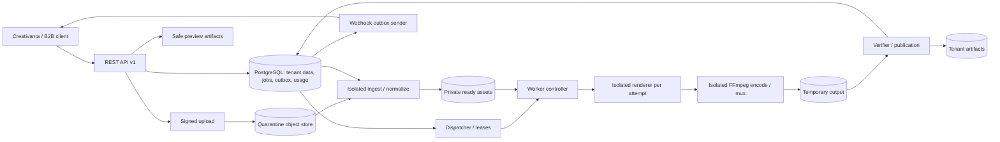
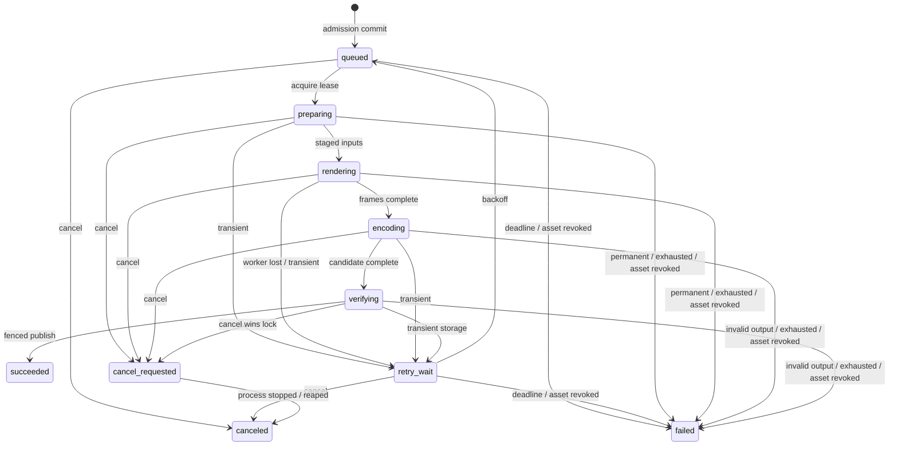

# Kiến trúc

Thiết kế chưa triển khai. [PRD](PRD.md) quy định scope, [API](API.md) quy định HTTP, [Scene spec](SCENE-SPEC.md) quy định timing. Lựa chọn renderer theo [ADR 0001](ADR/0001-engine-selection.md).

## Các plane và thành phần

- Control plane: TypeScript API, PostgreSQL, dispatcher, outbox, policy engine. API không import scene bundle hoặc chạy browser/FFmpeg.
- Data plane: ingest/render/encode/verify tách process/container; object store S3-compatible private. Controller có scoped grants, renderer không có DB/storage credentials.
- Authoring plane tùy chọn: provider adapter tạo draft code/schema → registry → isolated build/scan → gated execution. Không gọi AI trong deterministic render loop.
- Observability: structured logs/traces theo opaque IDs; không content/tokens/raw URLs. Usage ledger là dữ liệu bền, không suy ra billing từ log.

## Queue và dữ liệu

MVP chọn PostgreSQL làm source of truth và queue (`FOR UPDATE SKIP LOCKED`, transaction ngắn, lease/fencing token). Điều này giảm dịch vụ và cho phép atomic admission/outbox. Không cần Redis/BullMQ ở MVP; chỉ thêm broker thông báo khi benchmark chứng minh DB dispatch không đủ, vẫn giữ DB authoritative. Không giữ transaction suốt render.

Lease render job 60s, heartbeat 15s (tách biệt hoàn toàn với coding task lease 10min trong [AGY execution](AGENTS.md)). Mọi mốc thời gian lease (`lease_expires_at`, `heartbeat_at`) phải tính bằng đồng hồ PostgreSQL server (`now()`), không dùng đồng hồ cục bộ của worker để tránh lệch nhịp clock skew. Mỗi attempt có `attempt_id` và monotonic `lease_epoch`; lệnh renew/progress/publish bắt buộc khớp `(job_id, attempt_id, lease_epoch) AND lease_expires_at > now()`. Nếu renew trả về 0 dòng cập nhật, controller lập tức hủy tiến trình render của attempt đó. Lease expiry requeue bằng transaction có fence mới. Queue at-least-once, single logical publication; không hứa exactly-once execution. Round-robin tenant có pending job, FIFO trong tenant. Counters/locks giới hạn 2 active/tenant (`preparing/rendering/encoding/verifying/cancel_requested`), 20 pending admission (`queued + retry_wait`, tổng ≤22 non-terminal jobs/tenant) và slots global. Preview ưu tiên trọng số 2:1, tối đa 50% slots khi render chờ; không preempt/starve render.

| Nhóm thực thể (21 bảng chuẩn) | Invariant & Composite Keys |
| --- | --- |
| `tenants`, `api_keys`, `policies` | API key hash/scopes (`key_prefix`, `key_hash`); tenant lấy từ auth, không từ body; `policies` lưu quota/rate versioned |
| `templates`, `template_revisions` | PK/FK `(tenant_id, template_id, revision)` immutable; curated catalog dùng sentinel tenant `00000000-0000-0000-0000-000000000000` (`visibility='curated_public'`) read-only, fork sang tenant để sửa |
| `compositions`, `composition_revisions` | PK/FK `(tenant_id, composition_id, revision)` immutable JSON/hash/schema version; scene revision/hash nằm trong snapshot |
| `assets`, `asset_versions` | PK/FK `(tenant_id, asset_id, version)`; SHA-256, probe/MIME, bytes, rights, status (`uploading/processing/ready/rejected/deleted`); ready bytes immutable |
| `scene_bundles`, `scene_bundle_revisions` | PK/FK `(tenant_id, bundle_id, revision)`; source/build digests, capability manifest, review/security gate và runtime pin |
| `jobs`, `job_attempts`, `job_events` | PK/FK `(tenant_id, job_id)`; snapshot, profile, `state_version`, `attempt_id`/`lease_epoch` fence, cancel timestamp, monotonic `event_seq` |
| `artifacts` | Unique `(tenant_id, job_id, kind)` publication; checksum, bytes, expiry, private storage key |
| `idempotency_records` | Unique `(tenant_id, method, normalized_path, key)` + RFC 8785 `request_hash`, status/response encrypted-at-rest cho grants, `expires_at` (7d) |
| `outbox`, `webhook_endpoints`, `webhook_deliveries` | Event ghi vào `outbox` cùng transaction terminal job; `webhook_endpoints` và `webhook_deliveries` gắn composite FK `tenant_id` |
| `usage_reservations`, `usage_entries` | Reserve maximum budget khi admission; settle/release đúng một lần theo unique `(tenant_id, job_id, meter, ledger_version)` |

Mọi bảng thuộc sở hữu tenant đều có cột `tenant_id NOT NULL` và composite FK chứa `tenant_id`; áp dụng `ENABLE ROW LEVEL SECURITY` và `FORCE ROW LEVEL SECURITY` cộng kiểm tra tầng ứng dụng. Context tenant đặt qua `SET LOCAL app.current_tenant_id = '<uuid>'` trong từng transaction, tuyệt đối không dùng session-level `SET` rò qua connection pool. Năm DB roles tách biệt quyền tối thiểu cho `P3-01`: `cve_migrator` (DDL & seed `system_catalog`), `cve_api` (CRUD theo RLS tenant + chỉ đọc `system_catalog` khi `visibility='curated_public'`), `cve_dispatcher` (claim/reap/publish jobs), `cve_ingest` (probe/normalize quarantine sang ready assets), `cve_sender` (đọc `outbox` và ghi `webhook_deliveries`). Curated template không chứa tenant asset. Không dedupe/cache tenant-private bytes xuyên tenant ở MVP. Xem chi tiết quyết định hợp đồng tại [P0-04 report](../evidence/P0-04/report.md).

## Lifecycle và publication

`succeeded`, `failed`, `canceled` là ba trạng thái terminal. `queued`/`retry_wait` chuyển sang `failed` khi vượt `job_deadline_seconds` (`JOB_DEADLINE_EXCEEDED`), hết số lần thử hoặc khi asset đầu vào bị xóa/thu hồi (`ASSET_REVOKED`). Một khi job đã vào `cancel_requested` (do lệnh `POST /jobs/{id}/cancel` của khách thắng khóa dòng trước publication), trạng thái terminal hợp lệ duy nhất của nó là `canceled` (kể cả khi worker chết và được reaper thu hồi). Ngược lại, khi tenant gọi `DELETE /assets/{id}` thu hồi asset đang được tham chiếu bởi job chưa terminal, job đó bị chuyển sang `failed` với `error.code = "ASSET_REVOKED"` (`retryable: false`). Validation trước admission không tạo job. Terminal không hồi sinh: retry nghiệp vụ cần job mới/key mới. Event sequence/state_version tăng đơn điệu; percentage chỉ là gợi ý, có thể giảm sau retry.

1. Auth/scopes → schema/capability → asset ready/quyền → snapshot revisions/assets/runtime/seed → quota/estimate. Một DB transaction ghi idempotency claim, job, reservation, event. Trả 202 chỉ sau commit; DB fail trả 503.
2. Claim lease; controller stage approved bytes vào workspace riêng. Sandbox chỉ thấy manifest/assets read-only và output giới hạn. Asset revoked/quarantined thì fail, không fetch URL thay thế.
3. Compiler tạo render plan deterministic. Renderer prepare, seek từng frame, chờ readiness; encode có backpressure. Audio decode/mix ngoài browser.
4. Upload attempt-specific temp prefix; verifier probe/decode/check frame count và checksums. Upload xong chưa có nghĩa job thành công.
5. Publication transaction khóa job, kiểm fence/current attempt/cancel flag; ghi artifact refs, settle usage, succeeded và outbox. Object chỉ public qua DB-published refs. Orphan sweeper xóa temp >24h không referenced và không live lease.
6. Webhook gửi sau commit; lỗi callback không làm render failed. Polling authoritative.

Cancel/success cạnh tranh cùng row lock: terminal transaction đầu tiên thắng. Cancel thắng thì không publish, kill process group ≤10s và cleanup; reaper xử lý nếu worker chết. Success thắng thì cancel trả 409 `JOB_TERMINAL`. Operational usage vẫn ghi khi cancel/fail, không tính billed output-minute. Tổng ≤3 attempts; delay 5s rồi 30s + jitter, trong job deadline. Không retry schema/quyền/unsupported/malicious code. Profile timeout theo [Deployment](DEPLOYMENT.md).

## Renderer adapter và manifest

Contract dự kiến: `capabilities()`, `prepare(manifest, workspace)`, `renderFrame(frameIndex)`, `dispose()`. Worker sở hữu lifecycle, limits, decode/mix, encode; adapter không sở hữu tenant DB/billing/webhook. Capabilities gồm engine IDs, schema versions, fps/dimensions, media seek, fonts/easing và isolation requirements. Unsupported feature bị từ chối trước admission; không âm thầm đổi engine/bỏ scene.

Manifest pin adapter/compiler version, OCI digest, Chromium/FFmpeg build, font/asset hashes, composition/template revision, seed, profile, locale, encoder config. HyperFrames là ứng viên thử đầu tiên, `chromium-frame-v1` là fallback explicit. Không đổi renderer giữa attempts của một job; muốn fallback tạo job mới. Per-scene engine phải thuộc capabilities của adapter đã chọn. MVP engine `html-v1` là HTML do compiler sinh từ layer types được phép; `canvas-v1`, `svg-v1`, `custom-html-v1` chỉ bật khi adapter/gate tương ứng có. SVG layer trong HTML không đòi engine SVG riêng.

## Preview và assets

Preview job `kind=preview` dùng snapshot/compiler/runtime giống export; 360p, giữ fps, ≤10s đầu hoặc frame chỉ định. Output chỉ PNG/MP4, không serve arbitrary HTML trên API origin. Interactive custom preview sau này cần origin riêng, không cookie, policy riêng. Preview không chứng minh quality export 1080p.

Upload quarantine → size/magic bytes/rights → isolated probe/decode/sanitize → immutable ready object. Remote import chỉ qua ingest egress proxy. Font phải bundled/hash-pinned và có dấu Việt. TTS hoàn thành trước render admission, output là asset có model/voice/version provenance; không TTS live trong render.

## Failure modes

| Sự cố | Recovery/boundary | Test cần có |
| --- | --- | --- |
| Commit rồi mất HTTP response | Replay idempotency cùng job | Concurrent retry |
| Worker chết / stale lease | Requeue có fence; stale output không publish | Kill ở mọi stage |
| Storage full/down | Retry bounded, không succeed sớm | Fault injection + cleanup |
| DB down | Ngừng admission/publish; worker dừng khi không renew | Không double usage sau recovery |
| Noisy tenant | Quota + fair scheduling | Hai tenant cạnh tranh |
| Chromium/FFmpeg hang/OOM | cgroup/timeout kill, error typed | Host sống, workspace sạch |
| Callback down | Retry/dead-letter riêng | Job vẫn succeeded |
| Font/media thiếu | Fail rõ ràng, không Internet fallback | Offline render/hash check |
| Malicious custom code | Hard-isolated pool, default off | [Security gates](SECURITY.md) |

Artifact auth luôn kiểm tenant trước ký URL; prefix chỉ defense-in-depth. Backup/restore gồm DB và object references, reconciliation theo [Operations](OPERATIONS.md).
