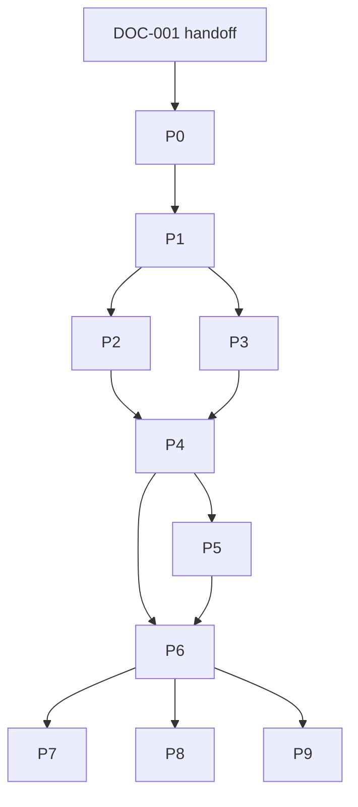

# Kế hoạch triển khai và handoff

Trạng thái: `DOC-001` thiết kế; **mọi task P0–P9 dưới đây chưa bắt đầu**. Không tự khởi động AGY từ phiên này. Handoff runner push docs và khởi động coding supervisor riêng. [AGENTS gốc](../AGENTS.md) quy định phạm vi; [AGY execution](AGENTS.md) quy định vận hành task; [Testing](TESTING.md) quy định evidence. Task ID là khóa truy vết từ plan → queue → branch/commit → PR/CI → artifact.

## Quy tắc thực thi

Mỗi task phải có owner, dependency IDs đã done, file scope, acceptance, evidence path, test commands/results và reviewer. Bảng dưới là backlog chuẩn; supervisor materialize vào durable queue, không tự đánh completed từ mô tả. Nếu cần chia nhỏ dùng suffix `.1`, `.2`, cập nhật plan/dependency cùng change. Không mở feature scope mới để né blocker. Docs có illustrative paths cho deliverables chưa tồn tại; agent phải tạo chúng khi task giao, không báo đã có.

`P1` = scaffold. `P2` = **ba video thực**, chưa là SaaS. `P4` = async tenant service. `P6` = private beta readiness. `P7` = custom code gated. `P8/P9` optional mở rộng theo nhu cầu/cost. Không chờ AI/browser editor để đạt P2. Manual/security/legal review cần người có thẩm quyền; agent có thể chuẩn bị report nhưng không tự nhận đã được legal sign-off.

## Workstreams và quyền sở hữu

| Stream | Scope tương lai | Điểm đồng bộ |
| --- | --- | --- |
| A — Contracts/control | schema/OpenAPI, DB/RLS, API, versioning | Freeze schema/API trước renderer/client integration |
| B — Render/media | compiler/adapters, fonts, audio, FFmpeg, POC, benchmarks | Consume schemas từ A; security runtime từ C |
| C — Security/infra | sandbox/launcher, ingest guard, CI, deployment/restore, observability | Gate runtime trước chạy untrusted inputs |
| D — Product/integration | template pack, TTS/provider contracts, Creativanta harness, usage UX/docs | Chỉ parallel khi core contracts ổn định |
| Supervisor/reviewer | durable queue, leases, conflict/PR/evidence review | Review độc lập thay agent tự mark done |

Tối đa 3 coding workers đồng thời + supervisor lúc đầu; D chạy khi slot rảnh, không cần 4 agents mọi lúc. File ownership leases; root manifests/lockfiles/OpenAPI/schema shared do một stream sở hữu mỗi lúc. Parallelism là hướng dẫn cho phiên AGY **sau handoff**, không yêu cầu spawn ở phiên docs.

## 0. P0 — kiểm chứng đầu vào và chuẩn bị quyết định

| Task / stream | Depends | Deliverable và acceptance |
| --- | --- | --- |
| P0-01 / Supervisor | DOC-001 | Đọc đủ docs, required-file/link check, ghi base commit, import backlog với status ready/blocked đúng dependencies; không tự tạo app trước scope review |
| P0-02 / C+B | P0-01 | Review exact HyperFrames/Chromium automation/FFmpeg/font artifacts: commit/version/integrity, install scripts, SBOM/license/NOTICE, vulnerabilities. Ghi allowed/blocked usage; chưa source-reviewed không install/run |
| P0-03 / D | P0-01 | Rights manifest cho assets/fonts/audio của 3 fixtures; tự tạo hoặc quyền thương mại rõ, hashes/source/license, không lấy demo upstream thiếu quyền |
| P0-04 / A+C | P0-01 | Contract/threat-model review: chốt starter limits, transitions, tenant entities, errors, lease/cancel/idempotency; mở issues cụ thể cho ambiguity, sửa docs cùng quyết định |
| P0-05 / Supervisor | P0-04 | Thiết lập task ledger/worktree policy/evidence template theo AGENTS, thử recovery bằng synthetic task state; credentials không vào queue/log |

Exit P0: evidence dependency review và fixture provenance; block runtime candidate bị từ chối, có documented fallback route. Timebox primary candidate audit 1 ngày công, blockers được triage thay research vô hạn.

## 1. P1 — scaffold có thể kiểm chứng, chưa có video

| Task / stream | Depends | Deliverable và acceptance |
| --- | --- | --- |
| P1-01 / C | P0-02, P0-04, P0-05 | TS workspace + pinned toolchain/lockfile + local Compose + env sample + ignore rules cho `.agy/`, `.worktrees/`, `.local/`. Reproducible install/build, health checks, README setup actual; không prod deploy |
| P1-02 / A | P0-04, P1-01 | Full JSON Schema 2020-12 + OpenAPI 3.1 + generated types/examples, expand mọi `$defs` fragment; unknown fields/invalid timing examples fail, valid fixture parse pass |
| P1-03 / B | P1-02 | Semantic validator/canonical compiler manifest: frames/rational time, scene references/hash/defaults/revisions, capability errors; boundary/property tests |
| P1-04 / C | P1-01, P0-02 | Minimal trusted-template sandbox/launcher: nonroot, Chromium sandbox, no egress, read-only inputs, cgroup/time/disk/PID limits, no host socket; self-test pass, custom off |
| P1-05 / A+C | P1-02, P1-04 | CI jobs docs/contracts/lint/typecheck/unit + migration smoke harness; secrets redacted, pinned runners/cache, evidence format standardized. No fake render pass |

Exit P1 = G1 scaffold only. Demo `healthz=200`, typecheck hoặc empty renderer **không** được gọi là platform tạo video.

## 2. P2 — first useful POC, ba MP4 thật và engine decision

| Task / stream | Depends | Deliverable và acceptance |
| --- | --- | --- |
| P2-01 / B | P1-03, P1-04, P0-03 | HyperFrames adapter spike và minimal Chromium/FFmpeg baseline trên same manifest. Prepare/seek/dispose, pinned runtime/encoder, no egress; random seek/capture đúng. 2 ngày công HyperFrames rồi blocker review |
| P2-02 / B+D | P2-01 | POC-01 promo 15s và POC-02 narrated explainer 30s; versioned editable template/scene JSON, font Việt, real frames/MP4; decode + expected counts + evidence |
| P2-03 / B | P2-01, P0-03 | POC-03 captioned footage 45s, CFR trim/crop, explicit audio mix, SRT/VTT, source hashes; sync anchors ≤1 frame, no clipping |
| P2-04 / B+C | P2-02, P2-03 | Benchmark both viable candidates theo Testing; 5 warm/3 cold runs, costs/utilization, RSS/RTF/quality; ADR E1–E6 evidence, chọn primary/fallback hoặc blocked có lý do |
| P2-05 / Reviewer | P2-04, P1-05 | Human watch/listen cả 3 MP4, golden frames/quality report, editable revision rerender; G2 sign-off và README actual video artifact/checksum links. Không gọi P2 done khi target fail chưa có ADR amendment |

Exit P2: video artifacts thực, cost/quality measured. Outputs `evidence/P2-05/report.md`, raw benchmark, manifest, ffprobe và video links/checksums/expiry; large binaries private artifact store, không commit media bừa bãi. Nếu chỉ một engine viable vẫn phải ghi baseline comparison unsupported/blocker, không bịa số.

## 3. P3 — tenant data và asset foundation

| Task / stream | Depends | Deliverable và acceptance |
| --- | --- | --- |
| P3-01 / A | P1-02, P0-04 | DB migrations entities/FKs/RLS/service roles/key hashes; tenant pool-context isolation và IDOR tests, rollback/recovery plan |
| P3-02 / C+A | P3-01, P1-04 | Signed upload/quarantine/complete/probe/normalize/ready pipeline, size/hash/rights/font/SVG guards; malformed media không thoát sandbox, foreign asset 404 |
| P3-03 / A+D | P3-01, P1-03, P0-03 | Template catalog/variable schema/instantiate, composition revision/concurrency, immutable scene versions; stale base_revision 409, curated fork path |
| P3-04 / C | P3-02 | Optional import connector behind off flag: DNS/connect/redirect SSRF defenses, tenant allowlist, rights provenance; adversarial suite pass trước bật |
| P3-05 / C+A | P3-02, P3-03 | Storage grants/retention/revoke/delete cascade/temp sweeper, tombstones/reference safety; unauthorized/revoked references bị chặn, cross-tenant URL tests. Live-job cancellation/publication integration hoàn tất và test ở P4-03 sau khi jobs tồn tại |

P3 có thể bắt đầu song song P2 sau P1, nhưng không chuyển nguồn lực khiến P2 chỉ còn scaffold. Exit: tenant assets/specs thật, public jobs chưa claim ready.

## 4. P4 — async VaaS API hoàn chỉnh

| Task / stream | Depends | Deliverable và acceptance |
| --- | --- | --- |
| P4-01 / A | P3-01, P3-03 | Admission transaction/idempotency/limits/reservations/capabilities; concurrent duplicate/key conflict/quota races pass, 202 only after durable commit |
| P4-02 / B+A | P4-01, P2-05, P3-02 | Postgres dispatcher/lease/heartbeat/fencing/fair scheduling + real renderer; state machine/events/attempts; stale worker không publish |
| P4-03 / C+B | P4-02, P3-05 | Cancel/timeout/retry/reaper, object temp verification/atomic publication; kill tests mọi stage, cancel-vs-success và asset-revoke-vs-publish races stable, no orphan leak |
| P4-04 / A+C | P4-01, P4-03 | Signed webhook registration/challenge/rotation/outbox/delivery/replay, bounded SSRF-safe retries; outage không mất event/job, HMAC raw bytes + dedupe tests |
| P4-05 / A | P4-01, P4-03 | Usage ledger/reserve/settle/release/operational vs billable reports; repeated completion không double debit, canceled/failed units tách rõ |
| P4-06 / B+D | P4-02, P4-03 | Frame/clip previews cùng compiler/runtime + download grant/thumbnails/captions/manifest; no raw custom HTML origin, 360p/full parity |
| P4-07 / Reviewer | P4-04, P4-05, P4-06 | G3 two-tenant E2E upload→template→preview→render→callback→download→decode và fault suite; artifacts thật cho same API path |

Exit P4: usable async API; test runner có real DB/store/worker, không thay bằng mock tất cả. API docs/examples phải phản ánh final implementation.

## 5. P5 — nội dung, adapter và Creativanta contract integration

| Task / stream | Depends | Deliverable và acceptance |
| --- | --- | --- |
| P5-01 / D+B | P4-07 | Curated template pack 3 families với variable schema/locales/revisions/license evidence, safe brand tokens/overflow errors; user edits regenerate đúng |
| P5-02 / D+C | P3-02, P0-02 | TTS interface/cache/provenance, upload audio fallback; provider/voice/model terms reviewed trước adapter enabled; failure/budget timeout, vi-VN quality sample nếu TTS bật |
| P5-03 / D+A | P4-07 | Creativanta **mock/contract client trong repo này**: external_reference/idempotency, signed webhook receiver, polling reconciliation, cancel, download-expiry refresh; no shared DB assumptions |
| P5-04 / A+D | P5-03 | API integration guide và generated SDK hoặc typed client example, v1 compatibility tests, error/retry examples; credentials chỉ placeholders |
| P5-05 / D+C | P5-01, P5-02 | Locale/font/audio regression matrix, subtitle import/sidecar/burn-in workflow và content rights controls; native Vietnamese reviewer sign-off cho beta samples |

Exit P5: dịch vụ chứng minh hợp đồng có thể được Creativanta tiêu thụ; **chưa sửa hoặc deploy Creativanta hiện hữu**. Task triển khai client bên ngoài phải do handoff riêng giao đúng repo/quyền, không được đánh done dựa harness.

## 6. P6 — readiness private beta, ops và recovery

| Task / stream | Depends | Deliverable và acceptance |
| --- | --- | --- |
| P6-01 / C | P4-07 | Metrics/traces/redacted logs/alerts/dashboards + per-tenant cost reporting; runbooks tái hiện job/queue/artifact/webhook issues bằng synthetic IDs |
| P6-02 / C+A | P6-01, P3-05 | Backup/PITR + object consistency + restore drill vào isolated env, measured RPO≤15min/RTO≤4h; custom/import stay off sau restore đến revalidation |
| P6-03 / C+B | P6-01, P2-04 | Load/capacity/fairness/24h soak ≥1000 valid jobs, cost model at 10/50/80% utilization; document capacity envelope và autoscale budget |
| P6-04 / Security reviewer | P6-02, P6-03, P4-07 | Structured renderer security suite, SBOM/license/codec/asset review, secrets/IDOR/SSRF/abuse/deletion; critical findings resolved hoặc beta blocked |
| P6-05 / Supervisor | P6-04, P5-04, P5-05 | G4 go/no-go report, immutable release/migration/rollback artifacts, SLO/error budget and support owner, exact staging smoke. Production deploy không tự được cấp bởi task này |

Exit P6: beta readiness có evidence; actual deployment/tenant onboarding chỉ theo authorization của môi trường. Single-node trial không quảng cáo HA/SLA chưa chứng minh.

## 7. P7 — optional AI-authored custom scene code

| Task / stream | Depends | Deliverable và acceptance |
| --- | --- | --- |
| P7-01 / C+Security reviewer | P6-04 | Custom runtime ADR + disposable microVM isolated build/render, no egress/secrets/host FS, bounds; gVisor alternative cần explicit review, không downgrade |
| P7-02 / A+D | P7-01, P1-02 | Versioned scene-bundle registry/source/build digests/parameter schema/provenance, full OpenAPI extension, editable revisions/download access; feature still off |
| P7-03 / D+C | P7-02 | Provider-neutral authoring adapter contract và ít nhất một non-premium-required route + deterministic mock; token/time/cost budgets, cancellation, source-only output. Codex/AGY/OpenCode/DeepSeek là tùy chọn, không bắt buộc subscription |
| P7-04 / C+B | P7-01, P7-02, P7-03 | Isolated build with approved imports, static scan + preview + malicious payload suite, no trusted API execution; source injection không đọc canary secrets |
| P7-05 / Security reviewer | P7-04 | C1–C6 signed review cho exact runtime digest, kill switch/canary/allowlist evidence; off-by-default regression và rollback test |
| P7-06 / D+B | P7-05, P5-01 | 3 custom scene variants từ same brief, editable versions và manifest, measured authoring/render cost, user preview/approval flow; enable chỉ tenant pilot đã được cấp |

Exit P7 không là điều kiện để structured API kiếm giá trị; thiếu virtualization/legal/provider quyền thì keep disabled, không làm blocker P4/P6.

## 8. P8 — optional browser export và specialized engines

| Task / stream | Depends | Deliverable và acceptance |
| --- | --- | --- |
| P8-01 / D+C | P6-05, P0-02 | WebAV/Mediabunny exact version/legal/browser-distribution review, capability matrix desktop/mobile/browser codec/security. No code shipping trước review |
| P8-02 / B+D | P8-01 | Browser export spike theo scene subset, unsupported feature fallback **server job mới**, memory/cancel/download/quality parity tests; offline assets chỉ scoped grants |
| P8-03 / B | P6-05 | Bounded VideoFlow/Revideo/Motion Canvas/PixiJS scene-engine spikes theo nhu cầu, CPU/license/security report; chọn tối đa một initial optional adapter bằng ADR |
| P8-04 / Reviewer | P8-02, P8-03 | Browser/specialized capability docs và acceptance matrix; refuse unsupported instead of silently degrade. Có thể conclude no-adoption với evidence, không fake support |

## 9. P9 — mở rộng thương mại theo dữ liệu

| Task / stream | Depends | Deliverable và acceptance |
| --- | --- | --- |
| P9-01 / C+A | P6-05 | Autoscaling implementation nếu queue metrics đòi hỏi, cooldown/drain/budget clamp; scale/load chaos test không double leases |
| P9-02 / A | P4-05, P6-05 | Usage export/quota plans/retention tiers, pricing simulation và reconciliation; billing processor riêng chỉ khi scope được cấp, không charging thật ở task này |
| P9-03 / A+C | P9-01 | DB/queue profiling; chỉ thêm broker khi evidence bottleneck, transactional outbox/fencing giữ nguyên; ADR và recovery tests |
| P9-04 / D+Supervisor | P5-04, P6-05 | External Creativanta handoff packet: base URL/env/scopes/fixtures/mapping/runbook; phối hợp integration task ngoài repo **chỉ sau quyền riêng**, ghi status harness vs live rõ ràng |
| P9-05 / Supervisor+Reviewer | P9-01, P9-02, P9-03, P9-04 | GA decision packet: capacity/cost/security/SLO/support/commercial legal/data residency, release/rollback. Optional P7/P8 không quảng cáo nếu chưa qua gate |

## Dependency graph và báo cáo

Task table là dependency chuẩn tắc chi tiết; graph chỉ theo milestone. Supervisor không chỉ báo `% files written`: report done/blocked task IDs, oldest heartbeat, PR/CI result commit, real video count/checksums, cost/quality gates, next ready tasks. Bằng chứng task ở `evidence/<task-id>/` là deliverable tương lai; commit compact sanitized reports, lưu raw/binary có retention/checksum. Mọi thay đổi budget/NFR có ADR amendment và reviewer; không tự nới gate để báo hoàn thành.

Handoff tối thiểu ngay sau docs: runner kiểm commit/docs → khởi động AGY tại repo này → claim P0-01 → parallel P0-02/P0-03/P0-04 sau đọc boundary → giữ custom/import off → làm P1 → ưu tiên G2 ba MP4 → tiến tới G3 async service. Không cần chọn model cao cấp; agent runner có thể chọn model sẵn dùng đáp ứng contract và evidence.
