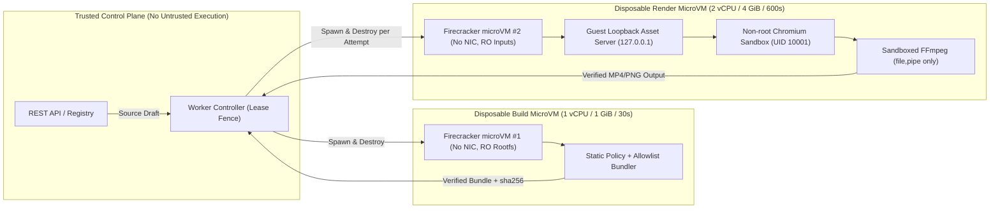

# ADR 0002 — Kiến trúc Custom Scene Runtime (Disposable MicroVM Isolation, Bounds & gVisor Explicit Review Policy)

- **Mã quyết định:** `ADR-0002`
- **Nhiệm vụ / Giai đoạn:** `P7-01` (`C+Security reviewer / P7`)
- **Ngày:** `2026-11-04`
- **Trạng thái:** **Accepted for P7 Architecture & Isolation Gate** (`CVE_CUSTOM_CODE_ENABLED=false` mặc định cho đến khi hoàn tất cổng ký duyệt `C1–C6` tại `P7-05` và cấp quyền pilot tại `P7-06`).
- **Tài liệu chuẩn tắc liên quan:** [AGENTS.md](../../AGENTS.md), [docs/SECURITY.md](../../docs/SECURITY.md), [docs/DEPLOYMENT.md](../../docs/DEPLOYMENT.md), [docs/ARCHITECTURE.md](../../docs/ARCHITECTURE.md), [docs/SCENE-SPEC.md](../../docs/SCENE-SPEC.md), [docs/TESTING.md](../../docs/TESTING.md), [docs/IMPLEMENTATION_PLAN.md](../../docs/IMPLEMENTATION_PLAN.md), [ADR 0001](../../docs/ADR/0001-engine-selection.md).

---

## 1. Bối cảnh và Mô hình mối đe dọa (Context & Threat Model)

Trong giai đoạn `P1–P6`, nền tảng Creativanta Video Engine chỉ thực thi các mẫu cảnh có cấu trúc (`html-v1`, `canvas-v1`, `svg-v1`) do bộ biên dịch nội bộ đã được kiểm toán (`@creativanta/contracts` và `@creativanta/renderers`) sinh ra từ dữ liệu JSON thuần túy. Ở mô hình có cấu trúc đó, khách hàng và AI không thể chèn mã JavaScript/TypeScript tùy ý vào trình kết xuất.

Giai đoạn `P7` giới thiệu tính năng tùy chọn **AI-authored / tenant-authored custom scene code** (`engine: "custom-html-v1"`, tham chiếu `bundle` đã biên dịch). Bất kỳ mã nguồn HTML/CSS/JS/TS nào do mô hình AI (`Codex`, `AGY Gemini`, `OpenCode`, `DeepSeek`, v.v.) hoặc người dùng cung cấp đều được xếp vào nhóm **hoàn toàn không tin cậy (untrusted arbitrary code)**:

1. **Nguy cơ thoát hộp cát trình duyệt và nhân hệ điều hành (Browser JIT / Kernel Escape):** Mã JS tùy ý chạy trong V8/Blink hoặc quy trình đóng gói (`build`) có thể chủ đích khai thác lỗ hổng trình biên dịch JIT, WebGL/Canvas rasterizer hoặc bề mặt lời gọi hệ thống (syscall) của nhân Linux chia sẻ.
2. **Không đủ nếu chỉ dùng bộ lọc tĩnh hoặc container thông thường:** Theo [docs/SECURITY.md](../../docs/SECURITY.md) (mục *Arbitrary agent/user code — mặc định disabled*):
   - Quét AST tĩnh (`static scan`), `node:vm`, `iframe` hoặc container Linux thông thường (`docker`/`runc` chia sẻ host kernel) **không đủ một mình** để bật thực thi mã tùy ý đa thuê bao (multi-tenant).
3. **Nguy cơ rò rỉ bí mật, truy cập siêu dữ liệu đám mây và hệ thống tệp máy chủ (Secrets, Egress & Host FS Exfiltration):** Mã độc trong lúc `build` hoặc `render` có thể tìm cách đọc biến môi trường chứa khóa API/DB/S3, kết nối ra mạng ngoài hoặc `169.254.169.254` (IMDS), hoặc truy cập hệ thống tệp máy chủ qua symlink/hardlink/mount.
4. **Nguy cơ tấn công từ chối dịch vụ (Resource Bombs):** Vòng lặp vô hạn (`while(true)`), bom bộ nhớ (allocation bomb), bom tiến trình (`fork` bomb), bom đĩa tạm (`disk` fill) hoặc giữ tiến trình sống quá thời hạn thuê bao (`stale lease`).

---

## 2. Quyết định kiến trúc (Architectural Decision)

### 2.1. Kiến trúc ưu tiên bắt buộc: Disposable MicroVM cho mỗi lần Build và mỗi Attempt Render

Hệ thống chọn **Disposable MicroVM** (máy ảo siêu nhẹ dùng một lần rồi hủy) làm lớp cô lập phần cứng bắt buộc bên ngoài cho toàn bộ khối lượng công việc `custom-html-v1`:

- **Hồ sơ runtime chuẩn (`microvm-firecracker-v1` và `microvm-kata-v1`):**
  - `microvm-firecracker-v1` (mặc định ưu tiên): Sử dụng Firecracker VMM + KVM (`/dev/kvm`) khởi chạy thông qua `jailer` dưới UID/GID không đặc quyền (`10001:10001`), hạt nhân khách (guest kernel) tối giản đã ghim mã băm `sha256:<64 hex>`, và ổ đĩa gốc chỉ đọc (`read-only rootfs` squashfs/ext4).
  - `microvm-kata-v1`: Hồ sơ tương thích OCI sử dụng Kata Containers VMM với phần cứng ảo hóa KVM riêng cho mỗi pod/sandbox attempt.
- **Tách biệt hai pha độc lập (Two-Phase Ephemeral MicroVM Separation):**
  1. **Isolated Build MicroVM (`custom-build-vm`):**
     - Chỉ nhận mã nguồn dự thảo (`source files`) đã qua kiểm tra hạn ngạch (`<= 100` tệp, `<= 5 MiB` mã nguồn, độ sâu thư mục `<= 8`) và danh sách gói phụ thuộc đã cài sẵn trong ảnh chỉ đọc (pre-installed allowlisted packages).
     - Tuyệt đối không có mạng (`0` NICs), không chạy `npm install` hoặc lifecycle hooks (`preinstall`/`install`/`postinstall`), không chạy trong tiến trình API hay controller/supervisor.
     - Đầu ra chỉ là gói tài sản tĩnh đã biên dịch (`<= 20 MiB`), bảng kê `build_sha256`, `source_sha256` và mã băm kịch bản CSP (`sha256-<base64>`). Ngay sau khi xuất kết quả và kiểm tra chữ ký, `custom-build-vm` bị hủy hoàn toàn (`destroy`).
  2. **Isolated Render MicroVM (`custom-render-vm`):**
     - Khởi tạo một microVM **mới hoàn toàn** cho mỗi `attempt` kết xuất hoặc xem trước (`job_id` + `attempt_id` + `lease_epoch`). Không bao giờ tái sử dụng microVM của bước `build` hoặc của `attempt` trước.
     - Bên trong microVM khách (guest VM), tiến trình kết xuất vẫn phải chạy dưới người dùng không đặc quyền `UID 10001 / GID 10001` (`cve-render`), bật đầy đủ **Chromium sandbox** (cấm tuyệt đối `--no-sandbox`), áp dụng bộ lọc `seccomp-bpf` và truyền đối số FFmpeg dạng mảng kèm `-protocol_whitelist "file,pipe"`.



---

## 3. Các bất biến bảo mật bắt buộc (Zero Egress, Zero Secrets, Zero Host FS & Hard Bounds)

| Ranh giới bảo mật | Quy tắc cưỡng chế kỹ thuật trong `@creativanta/custom-runtime` | Mã lỗi khi vi phạm |
| :--- | :--- | :--- |
| **No Egress (Cô lập mạng tuyệt đối)** | Cấu hình máy ảo có `network_interfaces: []` (không tạo TAP/veth/bridge/NAT, không cấp cổng mặc định hay DNS). Chính sách CSP khóa cứng `default-src 'none'; connect-src 'none'; object-src 'none'; frame-src 'none'; worker-src 'none'`, yêu cầu mã băm kịch bản `sha256-...` và cấm `unsafe-eval`. Máy chủ tài sản nội bộ chỉ gắn vào `127.0.0.1` bên trong sandbox và chỉ trả các tệp trong manifest khớp SHA-256. | `SANDBOX_SECURITY_VIOLATION` (`EGRESS_FORBIDDEN` / `FORBIDDEN_CAPABILITY_DETECTED`) |
| **No Secrets (Không rò rỉ bí mật)** | Môi trường khách chỉ nhận danh sách trắng cố định (`TZ=UTC`, `LANG=C.UTF-8`, `LC_ALL=C.UTF-8`, `HOME=/vm/tmp`, `TMPDIR=/vm/tmp`, `CVE_VM_PHASE`, `CVE_SANDBOX_JOB_ID`, `CVE_SANDBOX_ATTEMPT_ID`, `CVE_SANDBOX_LEASE_EPOCH`, `CVE_LOOPBACK_ASSET_ORIGIN`). Chặn truyền mọi khóa `SECRET`, `PASSWORD`, `PEPPER`, `TOKEN`, `API_KEY`, `DATABASE_URL`, `AWS_*`, `OPENAI_*`, `CVE_AUTHORING_SECRET_REF`. Toàn bộ luồng `stdout`/`stderr` bị giới hạn `<= 64 KiB` và lọc qua bộ che giấu hai lớp kèm bộ dò canary. | `SANDBOX_SECURITY_VIOLATION` (`SECRET_ENV_FORBIDDEN` / `CANARY_SECRET_LEAK_DETECTED`) |
| **No Host FS (Không chia sẻ hệ thống tệp máy chủ)** | Không gắn kết (mount) hệ thống tệp máy chủ, Docker/containerd/podman socket, SSH agent, `/proc`, `/sys`, `/dev`, `/etc`, `/root`, `.env`, `.git`, `.agy`, `.worktrees`. Đường dẫn chuẩn hóa từ ID nội bộ (`job_id`, `attempt_id`), chặn `..`, đường dẫn tuyệt đối, symlink, hardlink (`nlink > 1`), FIFO/device file và zip-slip. Đầu vào khóa quyền chỉ đọc (`0o440` tệp / `0o550` thư mục) trước khi khởi động microVM và xóa sạch (`rm -rf`) ngay khi đóng microVM. | `SANDBOX_SECURITY_VIOLATION` (`HOST_FS_MOUNT_FORBIDDEN` / `PATH_TRAVERSAL_BLOCKED`) |
| **Hard Resource Bounds (Giới hạn tài nguyên cứng)** | **Build VM:** `1 vCPU` (tối đa `2`), `1024 MiB` RAM (`swap = 0`), `128` PIDs, `512 MiB` đĩa tạm, timeout `30s`. **Render VM:** `2 vCPU` (tối đa `4`), `4096 MiB` RAM (`swap = 0`), `256` PIDs, `8192 MiB` đĩa tạm, frame timeout `5000ms`, render timeout `600s`, preview timeout `120s`, kill grace `<= 5000ms`. **Bundle v1:** `<= 100` tệp, `<= 5 MiB` source, `<= 20 MiB` built assets, độ sâu `<= 8`. Hủy toàn bộ nhóm tiến trình (`-pgid SIGKILL`) khi quá hạn hoặc mất lease fence. | `SANDBOX_RESOURCE_LIMIT` / `RENDER_TIMEOUT` / `FRAME_READINESS_TIMEOUT` |
| **Single-Use Disposable Lifecycle** | Mỗi thực thể microVM có máy trạng thái đơn hướng `allocated -> booted -> executing -> destroyed`. Mọi nỗ lực tái sử dụng cùng một microVM cho lần chạy thứ hai hoặc khác `(tenant_id, job_id, attempt_id, lease_epoch)` đều bị chặn tức thì và hủy máy ảo. | `SANDBOX_SECURITY_VIOLATION` (`MICROVM_REUSE_FORBIDDEN`) |

---

## 4. Đánh giá phương án thay thế gVisor (`runsc`) và Chính sách Cấm Hạ Cấp (Anti-Downgrade Policy)

Theo [docs/SECURITY.md](../../docs/SECURITY.md) (dòng 45) và yêu cầu nghiệm thu `P7-01` (*"gVisor alternative cần explicit review, không downgrade"*):

### 4.1. Phân tích kỹ thuật đối với gVisor (`gvisor-runsc-v1`)

| Tiêu chí | Disposable MicroVM (`microvm-firecracker-v1` / `microvm-kata-v1`) | gVisor Application Kernel (`gvisor-runsc-v1`) | Container thông thường (`docker` / `runc`) hoặc `node:vm` |
| :--- | :--- | :--- | :--- |
| **Ranh giới cô lập** | Phần cứng ảo hóa KVM (`/dev/kvm`) + hạt nhân khách tách biệt + VMM tối giản (`jailer`). | Nhân không gian người dùng (`Sentry` viết bằng Go) chặn syscalls + tiến trình `Gofer` cô lập I/O tệp. | Chia sẻ trực tiếp nhân Linux của máy chủ qua namespaces/cgroups/seccomp. |
| **Khả năng tương thích với Chromium + FFmpeg** | Tương thích 100% với nhân Linux chuẩn bên trong máy ảo khách; Chromium user-namespace sandbox hoạt động tự nhiên. | Có đánh đổi tương thích (theo tài liệu gVisor): một số lời gọi hệ thống nâng cao (`io_uring`, một số cờ `clone3`/shared memory phức tạp của Chromium) bị giả lập hoặc hạn chế. | Tương thích cao nhưng bề mặt tấn công nhân hệ điều hành lớn. |
| **Hiệu năng CPU & I/O** | Chi phí ảo hóa CPU gần như nguyên bản (< 3% overhead), khởi động < 150ms. | Chi phí chặn syscall (`systrap` / `kvm` platform) và truy cập tệp qua `Gofer` làm tăng thời gian biên dịch/kết xuất khung hình; **chưa được benchmark đạt ngưỡng RTF <= 6 trên nền tảng này**. | Nhanh nhưng không đạt yêu cầu bảo mật cho mã tùy ý đa thuê bao. |
| **Quyết định chính sách ở P7-01** | **APPROVED ARCH (Mặc định khi bật P7)** | **CONDITIONAL ALTERNATIVE — Yêu cầu Explicit Signed Security Review riêng trước khi kích hoạt** | **PERMANENTLY FORBIDDEN (Cấm tuyệt đối — Không bao giờ hạ cấp)** |

### 4.2. Quy tắc cưỡng chế trong mã nguồn đối với gVisor và Chống hạ cấp

1. **Cấm tuyệt đối việc tự động hạ cấp (Zero Downgrade Invariant):**
   - Nếu máy chủ triển khai không có `/dev/kvm` hoặc thiếu trình khởi chạy microVM (`firecracker` / `kata-runtime`), hệ thống **bắt buộc giữ tính năng custom code ở trạng thái tắt** (`CAPABILITY_DISABLED` / `VIRTUALIZATION_UNAVAILABLE`), đồng thời vẫn cho phép kết xuất các mẫu cảnh có cấu trúc (`html-v1`, `canvas-v1`, `svg-v1`) hoạt động bình thường.
   - Bất kỳ cấu hình nào đặt `CVE_CUSTOM_RUNTIME` thành `docker`, `runc`, `crun`, `containerd`, `podman`, `lxc`, `node-vm`, `iframe` hoặc `host` đều bị từ chối ngay lập tức với lỗi `SANDBOX_SECURITY_VIOLATION` (`reason: "RUNTIME_DOWNGRADE_FORBIDDEN"`).
2. **Điều kiện bắt buộc để phê duyệt `gvisor-runsc-v1` (Explicit Review Gate):**
   - Hồ sơ `gvisor-runsc-v1` mặc định bị khóa (`SANDBOX_SECURITY_VIOLATION` với `reason: "GVISOR_EXPLICIT_REVIEW_REQUIRED"`).
   - Hệ thống chỉ chấp nhận `gvisor-runsc-v1` khi có bản ghi phê duyệt tường minh (`GvisorExplicitReviewApproval`) đã được ký xác thực HMAC-SHA256 bởi Security Reviewer, bao gồm đầy đủ:
     - `adrAmendmentId`: Mã sửa đổi ADR đã được phê duyệt.
     - `reviewedRuntimeDigest`: Mã băm bất biến `sha256:<64 hex>` của bản dựng `runsc` và rootfs.
     - `escapeSuitePassed: true`, `compatibilitySuitePassed: true`, `resourceBoundsSuitePassed: true`, `noDowngradeVerified: true`.
     - Chữ ký `signatureHex` hợp lệ và chưa hết hạn (`expiresAt`).

---

## 5. Cổng phát hành bảo mật `C1–C6` (Release Gates trước khi bật tính năng ở P7-05 / P7-06)

Cấu hình mặc định trong repository sau `P7-01` giữ nguyên:

```json
{
  "CVE_CUSTOM_CODE_ENABLED": false,
  "CVE_CUSTOM_RUNTIME": "disabled",
  "CVE_CUSTOM_TENANT_ALLOWLIST": []
}
```

Trước khi bất kỳ tenant pilot nào được phép bật `CVE_CUSTOM_CODE_ENABLED=true` tại `P7-05`/`P7-06`, bộ kiểm tra `verifyC1ToC6Gates()` trong `@creativanta/custom-runtime` yêu cầu bằng chứng đã ký cho đủ 6 cổng:

- **`C1` (`threat_model_and_runtime_pin`):** Mô hình mối đe dọa `ADR-0002` và mã băm bất biến `sha256:<64 hex>` của guest kernel + rootfs image đã được rà soát.
- **`C2` (`isolated_build_and_no_egress`):** Kiểm thử biên dịch cô lập trong microVM dùng một lần và chứng minh `0` kết nối mạng ra ngoài (`network_interfaces: []`, `connect-src 'none'`).
- **`C3` (`escape_and_secret_canary_suite`):** Bộ kiểm thử chống thoát hệ thống tệp, tiến trình, biến môi trường bí mật và siêu dữ liệu đám mây (`169.254.169.254`).
- **`C4` (`resource_bombs_cancel_and_lease_fencing`):** Kiểm thử bom CPU/RAM/PID/đĩa tạm, hủy nhóm tiến trình `< 5s`, dọn sạch không gian làm việc và chặn xuất bản khi `lease_epoch` hết hạn.
- **`C5` (`tenant_preview_and_artifact_origin_auth`):** Cô lập nguồn gốc xem trước (không phục vụ HTML tùy ý trên origin của API) và kiểm tra quyền sở hữu tạo tác theo tenant.
- **`C6` (`security_reviewer_signed_attestation`):** Chữ ký phê duyệt của Security Reviewer gắn chặt với `runtime_image_digest`, công tắc ngắt khẩn cấp (`kill switch`) và danh sách trắng tenant pilot.
