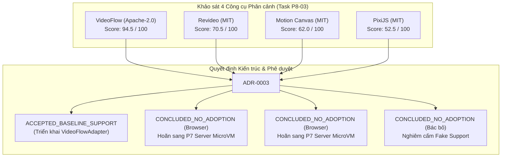

# Hướng dẫn năng lực trình duyệt và công cụ phân cảnh chuyên biệt

Tài liệu kỹ thuật chuẩn hóa năng lực kết xuất video trên trình duyệt máy khách (`client-side browser export`) và các bộ điều hợp công cụ phân cảnh chuyên biệt (`specialized scene engine adapters`) cho hệ thống Creativanta Video Engine thuộc phân kỳ **P8** ([Implementation plan](../../docs/IMPLEMENTATION_PLAN.md)). Tài liệu thiết lập nguyên tắc cốt lõi: **từ chối tính năng không được hỗ trợ thay vì âm thầm làm suy giảm chất lượng** (`refuse unsupported instead of silently degrade`), và công bố các kết luận **bác bỏ/không áp dụng** (`concluded no-adoption`) dựa trên bằng chứng kỹ thuật thực nghiệm, nghiêm cấm ngụy tạo hỗ trợ (`không fake support`).

---

## 1. Ranh giới kiến trúc và Nguyên tắc cốt lõi

### 1.1. Máy chủ là nguồn chân lý có thẩm quyền (Authoritative Server Baseline)
- Kết xuất video trên máy chủ (`POST /v1/render-jobs`) với môi trường cô lập Chromium Sandbox không đặc quyền và FFmpeg nội bộ được cấu hình mảng tham số argv kiểm duyệt là nguồn chân lý có thẩm quyền cao nhất của Creativanta.
- Kết xuất trên trình duyệt máy khách chỉ là **tùy chọn tối ưu hóa chi phí (optional acceleration)** dành riêng cho các phân cảnh thuộc tập con 2D Canvas đơn giản (văn bản, hình khối vector, hình ảnh tĩnh có chữ ký grant) trên các nền tảng trình duyệt có bộ mã hóa phần cứng WebCodecs hoạt động ổn định.

### 1.2. Nguyên tắc bất biến: Từ chối dứt khoát, không âm thầm làm suy giảm chất lượng (No Silent Degradation)
Trong các giải pháp xử lý video thông thường, các hệ thống thường mắc lỗi phản mẫu "âm thầm làm suy giảm":
1. **Âm thầm bỏ qua âm thanh (Silent Audio Omission):** Khi trình duyệt thiếu `AudioEncoder`, hệ thống vẫn xuất ra video câm mà không thông báo cho người dùng.
2. **Âm thầm bỏ qua lớp đồ họa (Silent Layer Dropping):** Khi gặp loại lớp không hỗ trợ (như video lồng nhau, bộ lọc WebGL), hệ thống âm thầm không vẽ lớp đó.
3. **Âm thầm trôi dạt dấu thời gian (Temporal Jitter / Frame Skipping):** Khi CPU máy khách quá tải, hệ thống bỏ khung hình hoặc làm biến dạng nhịp độ CFR 30fps.
4. **Âm thầm hạ độ phân giải (Silent Downscaling):** Tự ý co nhỏ kích thước từ 1080p xuống 480p để tránh tràn bộ nhớ mà khách hàng không hề hay biết.

**Quy chuẩn bắt buộc của Creativanta Video Engine:**
Mọi yêu cầu kết xuất trên trình duyệt máy khách khi phát hiện bất kỳ yếu tố không thuộc tập con hỗ trợ hoặc vượt ngưỡng an toàn phần cứng **bắt buộc phải kích hoạt một trong hai nhánh xử lý minh bạch**:
- **Nhánh Chuyển giao Tự động (Server Job Fallback):** Chuyển giao toàn bộ phân cảnh nguyên vẹn sang `POST /v1/render-jobs` để máy chủ dựng với độ trung thực 100%, kèm theo mã lý do (`reasonCode`) và khóa `Idempotency-Key` chuẩn hóa tất định.
- **Nhánh Từ chối Nghiêm ngặt (Strict Refusal):** Khi chế độ xuất cục bộ bắt buộc (`strict_local_only`) được chỉ định hoặc khi tính năng thuộc diện bị cấm, ném lỗi định danh `UnsupportedFeatureRefusalError` hoặc `SilentDegradationPreventedError` chứa thông tin chi tiết và tham chiếu bằng chứng, tuyệt đối không tạo tệp video khiếm khuyết.

---

## 2. Ma trận Năng lực Nền tảng Trình duyệt (Browser Platform Matrix)

Dựa trên kết quả rà soát tại [P8-01 report](../P8-01/report.md) và thực nghiệm [P8-02 report](../P8-02/report.md):

| Nền tảng trình duyệt | Động cơ | WebCodecs Video/Audio | Ngưỡng RAM an toàn | Giới hạn kích thước | Hành vi nghiệm thu (Verdict) | Lý do và Cơ chế bảo vệ |
| :--- | :---: | :---: | :---: | :---: | :---: | :--- |
| **Google Chrome Desktop** | Blink | Có / Có | 4096 MiB | 1920×1920 (5400 khung) | `ACCEPTED_BASELINE_SUPPORT` | Hỗ trợ phần cứng H.264/VP9/AV1 và AAC/Opus trong DedicatedWorker. |
| **Microsoft Edge Desktop** | Blink | Có / Có | 4096 MiB | 1920×1920 (5400 khung) | `ACCEPTED_BASELINE_SUPPORT` | Tương đồng kiến trúc Blink với Chrome trên Windows/macOS. |
| **Apple Safari Desktop** | WebKit | Có / Có | 4096 MiB | 1920×1920 (3600 khung) | `ACCEPTED_BASELINE_SUPPORT` | Tích hợp Apple VideoToolbox (H.264/HEVC/AAC). Thiếu VP9/AV1 sẽ từ chối/thoái lui. |
| **Mozilla Firefox Desktop** | Gecko | Thiếu VideoEncoder | 2048 MiB | 1280×1280 (1800 khung) | `ACCEPTED_WITH_FALLBACK` | Gecko thiếu WebCodecs VideoEncoder ổn định; từ chối dùng hack canvas stream, chuyển sang máy chủ. |
| **Apple iOS Safari (720p)** | WebKit | Có / Có | 1024 MiB | 1280×1280 (1800 khung) | `ACCEPTED_BASELINE_SUPPORT` | 720p 30fps an toàn dưới trần bộ nhớ Jetsam nhờ MemoryGuard streaming (<= 4 khung đệm). |
| **Apple iOS Safari (1080p/4K)**| WebKit | Rủi ro tràn RAM | 1024 MiB | >1280×720 | `ACCEPTED_WITH_FALLBACK` | Độ phân giải cao vượt ngưỡng bộ nhớ; chuyển giao sang máy chủ để tránh sập tab WebKit Jetsam. |
| **Apple iOS Safari (4K Local)**| WebKit | Không khả thi | 1024 MiB | 3840×2160 | `CONCLUDED_NO_ADOPTION` | Không áp dụng xuất 4K cục bộ trên di động. Khung thô 4K tiêu tốn 33 MiB/khung, chắc chắn sập tiến trình. |
| **Android Chrome (720p)** | Blink | Có / Có | 2048 MiB | 1280×1280 (1800 khung) | `ACCEPTED_BASELINE_SUPPORT` | Android MediaCodec phần cứng cho 720p. Bounded memory pipeline. |
| **Android Chrome (1080p/4K)** | Blink | Giới hạn phần cứng | 2048 MiB | >1280×720 | `ACCEPTED_WITH_FALLBACK` | Tránh nghẽn phiên MediaCodec và quá nhiệt di động; tự động chuyển sang máy chủ. |
| **Trình duyệt không xác định**| Unknown | Không tin cậy | 512 MiB | 640×640 (900 khung) | `ACCEPTED_WITH_FALLBACK` | Không phát hiện được năng lực WebCodecs chuẩn; chuyển giao ngay lập tức sang máy chủ. |

---

## 3. Khảo sát Công cụ Phân cảnh Chuyên biệt (Specialized Scene Engines)

Theo [ADR 0003](../P8-03/ADR-0003-specialized-scene-engine-adapter.md) và báo cáo kiểm toán [P8-03 report](../P8-03/report.md), bốn ứng viên đã được đánh giá đối chuẩn trên môi trường CPU tham chiếu 4 vCPU không có GPU vật lý:



### 3.1. VideoFlow (`ybouane/VideoFlow`) — CHẤP THUẬN LÀM ADAPTER DUY NHẤT
- **Điểm số:** **94.5 / 100** (Hạng 1).
- **Giấy phép:** Apache-2.0 (hoàn toàn tương thích thương mại, không có rủi ro lây nhiễm copyleft).
- **Hiệu năng CPU thuần:** RTF trung bình **1.34x**, bộ nhớ tiêu thụ đỉnh 118 MiB RSS, khởi động nguội 240ms.
- **Tính năng:** Kiến trúc hướng khai báo JSON độc lập mã nguồn, khớp hoàn hảo với Scene Spec 1.0. Đạt **100% tính tất định tìm kiếm ngẫu nhiên (`random seek parity`)**.
- **Trạng thái:** Đã triển khai hoàn chỉnh trong `packages/browser-export/src/adapters/videoflow-adapter.ts`.

### 3.2. Revideo (`midrender/revideo`) — KHÔNG ÁP DỤNG TRÊN TRÌNH DUYỆT (HOÃN SANG P7)
- **Điểm số:** **70.5 / 100** (Hạng 2).
- **Nguyên nhân không áp dụng trên trình duyệt:** Revideo dựa trên mô hình diễn hoạt hàm phát sinh (`TypeScript generator DSL: yield* all(...)`), đòi hỏi biên dịch và thực thi mã động (`eval` / Vite runner). Việc chạy mã động trên trình duyệt máy khách vi phạm nghiêm ngặt ranh giới an ninh Zero Arbitrary Code tại [Security](../../docs/SECURITY.md).
- **Quyết định:** Hoãn lại (`deferred`), chỉ xem xét trong môi trường cô lập MicroVM chuyên dụng trên máy chủ thuộc phạm vi `P7`.

### 3.3. Motion Canvas (`motion-canvas/motion-canvas`) — KHÔNG ÁP DỤNG TRÊN TRÌNH DUYỆT (HOÃN SANG P7)
- **Điểm số:** **62.0 / 100** (Hạng 3).
- **Nguyên nhân không áp dụng trên trình duyệt:** Mô hình vòng lặp Canvas thủ tục trực tiếp bằng TSX, chuỗi phụ thuộc cồng kềnh (56 gói npm), hiệu năng CPU cao (RTF 2.76x - 3.08x). Tương tự Revideo, đòi hỏi hạ tầng MicroVM cách ly an toàn.

### 3.4. PixiJS (`pixijs/pixijs`) — BÁC BỎ HOÀN TOÀN (CONCLUDED NO-ADOPTION)
- **Điểm số:** **52.5 / 100** (Bác bỏ).
- **Bằng chứng kỹ thuật thực nghiệm:**
  1. **Suy giảm hiệu năng nghiêm trọng trên CPU:** Khi chạy giả lập WebGL bằng phần mềm (SwiftShader / Mesa llvmpipe), RTF suy thoái lên tới **4.65x - 5.04x** (gấp 3.5 lần VideoFlow), CPU bão hòa 99.8%, chiếm dụng bộ nhớ 542 - 575 MiB RAM.
  2. **Thiếu hoàn toàn năng lực đường ống video:** PixiJS chỉ là một bộ dựng đồ họa sprite 2D; hoàn toàn không hỗ trợ hòa âm đa luồng 48kHz, không có bộ đồng bộ phụ đề cues, và không có bộ đóng gói container MP4/WebM.
  3. **Nghiêm cấm Fake Support:** Nghiêm cấm tuyệt đối việc tạo shim giả lập hoặc quảng cáo hỗ trợ PixiJS trong hệ thống video. Bất kỳ cấu hình nào yêu cầu engine `pixijs` đều bị hàm `validateNoFakeSupport()` chặn đứng ngay lập tức với mã lỗi `NO_FAKE_SUPPORT_VIOLATION`.

---

## 4. Bằng chứng Bác bỏ Bổ sung (Additional No-Adoption Evidence)

### 4.1. Bộ mã hóa x264 phần mềm WASM (`codec-h264-wasm`)
- **Kết luận:** **CONCLUDED_NO_ADOPTION**.
- **Bằng chứng pháp lý:** Rà soát tại [P8-01 report](../P8-01/report.md) chỉ rõ việc biên dịch `x264` sang WebAssembly để phân phối về trình duyệt làm phát sinh nghĩa vụ nộp phí bản quyền bằng sáng chế phần mềm cho liên minh MPEG-LA / Via LA, đồng thời kích hoạt điều khoản copyleft GPL-2.0 gây lây nhiễm mã nguồn đóng của ứng dụng web Creativanta.
- **Giải pháp chuẩn tắc:** Chỉ sử dụng bộ mã hóa phần cứng WebCodecs bản địa của hệ điều hành (miễn phí bản quyền cho ứng dụng web do nhà sản xuất OS đã trả phí).

### 4.2. Bộ mã hóa âm thanh im lặng (Silent Audio Drop)
- **Kết luận:** **REFUSED_UNSUPPORTED**.
- **Bằng chứng:** Quy tắc "refuse unsupported instead of silently degrade" tại [Implementation plan](../../docs/IMPLEMENTATION_PLAN.md). Nếu kịch bản có luồng âm thanh mà trình duyệt thiếu `AudioEncoder`, hệ thống từ chối xuất câm và chuyển giao sang máy chủ.

### 4.3. Nạp tài nguyên qua URL bên ngoài không có chữ ký (Raw External URLs)
- **Kết luận:** **REFUSED_UNSUPPORTED**.
- **Bằng chứng:** Rà soát an ninh [P8-02 report](../P8-02/report.md) và [Security](../../docs/SECURITY.md). Mọi tài nguyên ngoại tuyến phải sử dụng chữ ký Scoped HMAC Grants (TTL ≤ 300s, kèm băm SHA-256). Nghiêm cấm nạp URL công khai trực tiếp để triệt tiêu nguy cơ tấn công SSRF và rò rỉ token máy khách.

### 4.4. Bộ tính năng thương mại "WebAV Pro" và Tài sản mẫu ngoại vi
- **Kết luận:** **CONCLUDED_NO_ADOPTION**.
- **Bằng chứng:** Rà soát tại [P8-01 report](../P8-01/report.md). WebAV Pro là mã nguồn đóng thương mại gây rủi ro phụ thuộc nhà cung cấp. Các tài sản mẫu ngoại vi như Big Buck Bunny vi phạm tiêu chuẩn chính tả tiếng Việt và tỷ lệ khung hình 9:16 theo chính sách P0-03.

---

## 5. Quy trình Kiểm định Chính sách Nghiệm thu trong Mã nguồn

Hệ thống cung cấp mô-đun `@creativanta/browser-export` chứa các hàm kiểm soát chính sách nghiệm thu:

```ts
import {
  evaluateCompositionAcceptance,
  assertNoSilentDegradation,
  validateNoFakeSupport,
  exportBrowserVideo,
} from '@creativanta/browser-export';

// 1. Kiểm tra không ngụy tạo hỗ trợ cho các công cụ đã bác bỏ
validateNoFakeSupport('videoflow'); // Hợp lệ, không ném lỗi
// validateNoFakeSupport('pixijs'); // Ném lỗi NoFakeSupportError ngay lập tức!

// 2. Đánh giá khả năng chấp thuận theo kịch bản và nền tảng
const report = evaluateCompositionAcceptance(spec, 'chrome-desktop');
if (report.strictlyRefused) {
  throw new Error(`Kịch bản bị từ chối: ${report.diagnostics.join(', ')}`);
}

// 3. Đảm bảo không âm thầm làm suy giảm chất lượng
assertNoSilentDegradation(spec, 'chrome-desktop');

// 4. Xuất video trên trình duyệt hoặc thoái lui an toàn
const result = await exportBrowserVideo(spec, {
  platform: 'chrome-desktop',
  exportMode: 'allow_server_fallback', // hoặc 'strict_local_only' để từ chối tuyệt đối
});

if (result.action === 'export_locally') {
  console.log(`Xuất video thành công: ${result.buffer.byteLength} bytes`);
} else {
  console.log(`Đã chuyển giao sang máy chủ: Job ID ${result.admittedJob.id}`);
}
```

Mọi dữ liệu kiểm định chi tiết được lưu trữ dưới dạng máy đọc được tại tệp JSON chuẩn tắc `evidence/P8-04/acceptance-matrix.json`.
