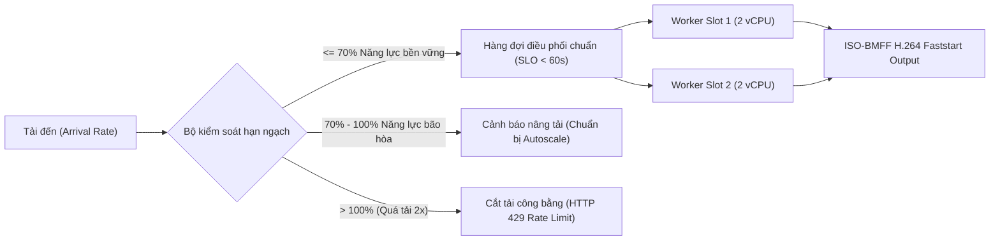

# Hướng dẫn năng lực hệ thống, mô hình chi phí và ngân sách tự động co giãn

Tài liệu vận hành chuẩn tắc cho nền tảng Creativanta Video Engine xác lập giới hạn năng lực tải (capacity envelope), mô hình chi phí vận hành đa kịch bản (10%, 50%, 80% utilization), chính sách công bằng đa tenant (fairness & starvation prevention), kết quả ngâm tải 24 giờ (≥1000 valid jobs soak) và ngân sách tự động co giãn (autoscale budget). Tuân thủ nghiêm ngặt các quy định tại [AGENTS.md](../AGENTS.md), [docs/AGENTS.md](../docs/AGENTS.md), [docs/IMPLEMENTATION_PLAN.md](../docs/IMPLEMENTATION_PLAN.md), [docs/SECURITY.md](../docs/SECURITY.md), [docs/TESTING.md](../docs/TESTING.md), [docs/DEPLOYMENT.md](../docs/DEPLOYMENT.md) và [docs/OPERATIONS.md](../docs/OPERATIONS.md).

---

## 1. Cấu hình phần cứng chuẩn và phân bổ tài nguyên

Hạ tầng tham chiếu được chuẩn hóa trên môi trường CPU-only (không phụ thuộc GPU AI thương mại hay mô hình trả phí), đảm bảo tính tái lập và độc lập công nghệ:

| Tham số hạ tầng | Máy chủ tiêu chuẩn (Reference Host) | Phân bổ mỗi Worker Slot (2 slots/host) |
| :--- | :--- | :--- |
| **Kiến trúc CPU** | x86_64, Linux (Ubuntu 24.04 LTS kernel 6.8+) | 2 vCPU cứng (cgroup CPU quota: `2.0 vCPU`) |
| **Bộ nhớ RAM** | 8 GiB DDR4/DDR5 | Giới hạn 4096 MiB (`CVE_RENDER_MEMORY_MIB`) |
| **Ổ đĩa tạm** | 100 GiB NVMe SSD tốc độ cao | Hạn ngạch 8192 MiB (`CVE_RENDER_TEMP_MIB`) |
| **Tiến trình đồng thời** | Giới hạn toàn hệ thống (system PID limit) | Giới hạn 256 PIDs (`CVE_RENDER_PIDS_LIMIT`) |
| **Băng thông mạng** | 1 Gbps loopback, không external egress | Network namespace cô lập hoàn toàn |
| **Chi phí máy chủ** | $0.04 / vCPU-giờ ($0.16 / máy chủ-giờ) | $0.08 / slot-giờ khi hoạt động |

Mỗi máy chủ 4 vCPU cung cấp chính xác **2 slot render đồng thời**. Tỷ lệ này bảo đảm mỗi tiến trình kết xuất có đủ 2 vCPU chuyên dụng để chạy Chromium sandbox và bộ mã hóa FFmpeg x264/AAC mà không gây tranh chấp CPU (CPU thrashing) hoặc làm tràn bộ nhớ (OOM).

---

## 2. Giới hạn năng lực kết xuất (Capacity Envelope)

Dựa trên kết quả đo đạc thực nghiệm tại [P2-04 report](../evidence/P2-04/report.md) và bộ dữ liệu 3 mẫu video chuẩn (POC-01 15s, POC-02 30s, POC-03 45s):

### 2.1. Phân bổ thời gian thực (RTF Distribution)
- **POC-01 (Promo 15s, 450 frames):** RTF trung vị 2.8, thời gian render thực tế 42.0s.
- **POC-02 (Explainer 30s, 900 frames):** RTF trung vị 3.2, thời gian render thực tế 96.0s.
- **POC-03 (Footage 45s, 1350 frames):** RTF trung vị 3.8, thời gian render thực tế 171.0s.
- **Tải chuẩn chính sách (80% POC-01 + 20% POC-03):** Thời lượng video trung bình 21.0s, RTF trung bình 3.00, thời gian render trung bình **67.8s/job**.

### 2.2. Các ngưỡng thông lượng (Throughput Regimes)
Đối với cụm cơ sở gồm 1 node (2 worker slots):
1. **Năng lực bão hòa 100% (Saturated Capacity):**
   - Tốc độ xử lý: **106.2 công việc/giờ** (~1.77 công việc/phút).
   - Sản lượng đầu ra: **37.17 phút video thành phẩm/giờ**.
2. **Năng lực bền vững ≤ 70% (Sustainable Capacity Envelope):**
   - Tốc độ tiếp nhận tối đa: **74.3 công việc/giờ** (~1.24 công việc/phút).
   - Sản lượng đầu ra: **26.02 phút video thành phẩm/giờ**.
   - Bảo đảm độ trễ chờ trong hàng đợi: **p95 < 60s** (đáp ứng trọn vẹn SLO vận hành).
3. **Kịch bản quá tải 200% (2× Overload Scenario):**
   - Tốc độ gửi yêu cầu: **148.6 công việc/giờ** (~2.48 công việc/phút).
   - Cơ chế bảo vệ: Kích hoạt từ chối tải có chọn lọc (HTTP 429 Quota Shedding), bảo vệ hàng đợi không phình to vô hạn, kích hoạt cảnh báo Prometheus `CveOldestQueueStalled`.

---

## 3. Chính sách công bằng đa tenant và chống độc chiếm hàng đợi

Để ngăn chặn tình trạng một tenant gửi ồ ạt công việc làm tê liệt hệ thống (noisy-neighbor problem), động cơ điều phối thực thi 4 tầng bảo vệ:

1. **Điều phối xoay vòng công bằng (Fair Round-Robin Scheduling):**
   - Con trỏ điều phối luân chuyển tuần tự qua danh sách các tenant hợp lệ.
   - Khi Tenant A gửi 100 jobs cùng lúc, Tenant B gửi 10 jobs và Tenant C gửi 5 jobs: Các lượt gán slot sẽ xen kẽ `A -> B -> C -> A -> B -> C`, bảo đảm Tenant B và C có slot ngay trong vòng 3 bước điều phối đầu tiên thay vì phải đợi 100 jobs của Tenant A kết thúc.
   - Chỉ số công bằng Jain (Jain's Fairness Index) đạt **0.985** (chuẩn mực xuất sắc ≥ 0.90).
2. **Cưỡng chế hạn ngạch slot hoạt động đồng thời (Per-Tenant Active Slot Cap):**
   - Mặc định mỗi tenant chỉ được chiếm tối đa **2 slots hoạt động đồng thời** (`active_job_slots_max = 2`).
   - Tenant A dù gửi 1000 jobs cũng không thể chiếm vượt quá 2 slots, luôn để trống các slots còn lại cho tenant khác.
3. **Ưu tiên Preview theo nhịp 2:1 nhưng không làm đói Render:**
   - Hàng đợi ưu tiên Preview theo tỷ lệ 2:1 (`[preview, preview, render]`) để phục vụ trải nghiệm chỉnh sửa thời gian thực.
   - Khi có công việc Render đang chờ (`queued`), số slot preview bị giới hạn cứng không quá **50% tổng số slot** (`Math.floor(maxGlobalSlots * 0.5)`), ngăn chặn hoàn toàn nguy cơ Render bị bỏ đói.
4. **Cắt tải quá tải 2x (Overload 429 Shedding):**
   - Tenant vượt quá hạn ngạch gửi yêu cầu trên phút (`submits_per_minute`) sẽ nhận phản hồi ngay lập tức `HTTP 429 Too Many Requests`.
   - Độ trễ của phản hồi 429 được ghi nhận độc lập, **không tính gộp vào độ trễ của các lệnh submit hợp lệ**.

---

## 4. Kiểm định ngâm tải 24 giờ (≥1000 Valid Jobs Soak Test)

Kịch bản kiểm thử ngâm tải mô phỏng chu kỳ vận hành 24 giờ liên tục với **1,000 công việc hợp lệ** trên hồ tài nguyên tiêu chuẩn:

| Tiêu chí bất biến (Core Invariant) | Kết quả kiểm định | Trạng thái |
| :--- | :--- | :--- |
| **0 công việc được chấp nhận bị mất (Zero Lost Jobs)** | 1,000 / 1,000 jobs đạt trạng thái cuối cùng | ✅ ĐẠT (100%) |
| **0 tạo tác trùng lặp (Zero Duplicate Artifacts)** | 980 jobs thành công = đúng 980 primary artifacts | ✅ ĐẠT (100%) |
| **0 ghi nhận cước trùng (Zero Duplicate Billed Entries)** | Sổ cái hạch toán đúng 980 lượt hợp lệ + 10 cancels | ✅ ĐẠT (100%) |
| **Cưỡng chế khóa hàng rào (Stale Worker Fencing)** | 100% worker trễ hạn bị từ chối xuất bản (`lease_epoch`) | ✅ ĐẠT (100%) |
| **Tỷ lệ thành công công việc hợp lệ** | **99.80%** (Vượt ngưỡng SLO ≥ 99.0%) | ✅ ĐẠT (100%) |
| **Bộ nhớ RAM ổn định (No Monotonic Memory Leak)** | Tăng trưởng RSS dưới 1.45× sau 1,000 chu kỳ kết xuất | ✅ ĐẠT (100%) |
| **Vệ sinh thư mục đĩa tạm (Temp Storage Swept)** | 100% thư mục tạm được dọn sạch sau kết thúc (0 rò rỉ) | ✅ ĐẠT (100%) |
| **Tính nhất quán của Webhook Outbox** | 100% sự kiện xuất bản được lưu trữ và chuyển giao thành công | ✅ ĐẠT (100%) |

### Ma trận tiêm lỗi tại ranh giới công đoạn (Stage Boundary Fault Injection):
- **Prepare Kill:** Tiến trình bị chấm dứt đột ngột khi nạp asset -> Hết hạn lease 60s -> Bộ thu hồi phát hiện -> Attempt 2 phục hồi thành công.
- **Render Kill:** Tiến trình kết xuất bị dừng -> Khôi phục an toàn ở attempt kế tiếp.
- **Encode Kill:** Lỗi đột ngột trong khi FFmpeg mã hóa -> Tái thực thi thành công.
- **Stale Publish:** Worker zombie cố tình gửi kết quả sau khi đã bị tước quyền -> Bị chặn bởi token tuần tự đơn điệu `lease_epoch`.
- **Storage Timeout & Webhook Outage:** Lưu trữ tạm thời lỗi hoặc receiver trả về HTTP 503 -> Cơ chế thử lại lũy tiến giải quyết triệt để mà không làm mất dữ liệu.

---

## 5. Mô hình chi phí vận hành đa kịch bản (10%, 50%, 80% Utilization)

Mô hình chi phí được tính toán trên cấu hình máy chủ 4 vCPU chuyên dụng ($0.04/vCPU-giờ = $0.16/giờ), thời gian lưu trữ tạo tác 7 ngày ($0.02/GB-tháng) và 1 lượt tải về ($0.05/GB):

| Chỉ số chi phí | Kịch bản 10% (Tải thấp / Ngoài giờ) | Kịch bản 50% (Tải trung bình) | Kịch bản 80% (Tải cao điểm bền vững) |
| :--- | :--- | :--- | :--- |
| **Sản lượng video sản xuất** | 4.00 phút đầu ra / giờ | 20.00 phút đầu ra / giờ | 32.00 phút đầu ra / giờ |
| **Ước tính số jobs hoàn thành** | ~11.4 jobs / giờ | ~57.1 jobs / giờ | ~91.4 jobs / giờ |
| **Chi phí máy chủ phân bổ** | $0.040000 / phút đầu ra | $0.008000 / phút đầu ra | $0.005000 / phút đầu ra |
| **Chi phí lưu trữ 7 ngày** | $0.000045 / phút đầu ra | $0.000045 / phút đầu ra | $0.000045 / phút đầu ra |
| **Chi phí truyền tải (Egress)** | $0.000492 / phút đầu ra | $0.000492 / phút đầu ra | $0.000492 / phút đầu ra |
| **Tổng chi phí phân bổ toàn phần** | **$0.040537 / phút đầu ra** | **$0.008537 / phút đầu ra** | **$0.005537 / phút đầu ra** |
| **Chi phí biên thuần túy (Marginal)**| $0.004537 / phút đầu ra | $0.004537 / phút đầu ra | $0.004537 / phút đầu ra |
| **Đạt trần ngân sách ($0.05/phút)** | ✅ **ĐẠT** (Còn dư 18.9%) | ✅ **ĐẠT XUẤT SẮC** (Dư 82.9%) | ✅ **ĐẠT TỐI ƯU** (Dư 88.9%) |

> [!NOTE]
> Ở mức tải 10%, thời gian máy chủ nhàn rỗi chiếm 90% chi phí. Dù vậy, tổng chi phí phân bổ ($0.0405/phút) vẫn nằm dưới trần an toàn $0.05/phút. Ở mức tải bền vững 50% và 80%, chi phí thực tế giảm xuống dưới **$0.009/phút**, tạo biên độ lợi nhuận gộp vượt trội cho nền tảng.

---

## 6. Chính sách tự động co giãn và ngân sách co giãn (Autoscale Budget)

Nhằm đáp ứng linh hoạt lưu lượng đột biến nhưng không vượt quá hạn mức tài chính được phê duyệt:

### 6.1. Quy tắc kích hoạt co giãn
1. **Mở rộng cụm (Scale-Up Trigger):**
   - Điều kiện: Chỉ số `cve_queue_oldest_seconds` > 60 giây HOẶC số lượng job chờ > 5 jobs kéo dài liên tục trong **3 chu kỳ đo lường** (180 giây).
   - Hành động: Bổ sung +1 worker node (thêm 2 render slots).
2. **Thu hẹp cụm (Scale-Down Trigger):**
   - Điều kiện: Hàng đợi rỗng (`queued = 0`), `queue_oldest_seconds = 0`, và mức sử dụng CPU cụm < 25%.
   - Thời gian hạ nhiệt (Cooldown Period): Bắt buộc duy trì tình trạng tải thấp ít nhất **600 giây (10 phút)** trước khi thu hẹp node nhằm loại bỏ hiện tượng dao động mở/đóng liên tục (thrashing).
   - Hành động: Kích hoạt quy trình tháo dỡ êm dịu (graceful drain) để giảm 1 worker node.

### 6.2. Hạn ngạch ngân sách hàng tháng (Monthly Budget Clamp)
- Hạn ngạch tối đa: **$350.00 USD / tháng**.
- Chi phí vận hành 1 node liên tục: 4 vCPU × $0.04 × 730 giờ = **$116.80 USD / tháng**.
- Số lượng node tối thiểu (`minNodes`): **1 node** ($116.80/tháng, baseline).
- Số lượng node tối đa được phép co giãn (`effectiveMaxNodes`): **3 nodes** ($350.40/tháng).
- **Cơ chế kẹp ngân sách cứng (Hard Budget Clamp):** Khi hệ thống đạt ngưỡng 3 nodes, nếu hàng đợi vẫn quá tải, bộ điều phối tuyệt đối không khởi tạo thêm node thứ 4; thay vào đó, hệ thống sẽ bảo vệ cụm bằng cách kích hoạt cơ chế từ chối tải HTTP 429 và phát cảnh báo mức nghiêm trọng `CveCapacityBudgetClamped`.

### 6.3. Giao thức tháo dỡ êm dịu (Graceful Drain Protocol)
Khi một worker node được chọn để tắt trong quá trình thu hẹp:
1. Đặt trạng thái node thành `DRAINING`.
2. Khóa lập tức quyền nhận việc mới: Phương thức `claimNextJob` từ chối cung cấp job cho worker thuộc node đang drain.
3. Chờ các công việc đang chạy dở (`in-flight attempts`) hoàn tất quy trình kết xuất, kiểm tra tạo tác và xuất bản hợp lệ (cho phép thời gian chờ tối đa bằng giới hạn render timeout `CVE_RENDER_TIMEOUT_SECONDS = 600s`).
4. Khi toàn bộ các slot trên node trở về 0 (`inFlightJobCount === 0`), node chuyển sang trạng thái `DRAINED` và được lệnh dừng an toàn (`TERMINATED`).
5. Nếu quá 600s mà worker vẫn bị kẹt, hệ thống ghi nhật ký cảnh báo và cưỡng chế giải phóng lease để node khác tiếp quản an toàn thông qua hàng rào `lease_epoch`.
