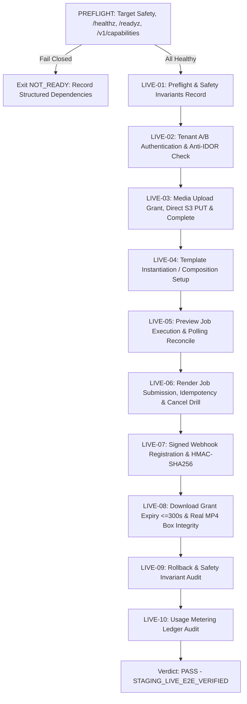

# Non-Mock Live Staging E2E Verifier

Operator guide and technical specifications for the non-mock live staging end-to-end verification harness of Creativanta Video Engine.

- **Task**: P10-B (GitHub issue #66, parent #63)
- **Scope**: Operator-invoked non-mock live HTTP staging verification harness
- **Classification**: Staging-only verifier. **Production deployment is strictly prohibited and denied by default.**

---

## 1. Problem Statement & Verified Starting Gap

Prior to Task P10-B, the staging smoke verification suite (`ops/release/staging-smoke-runner.mjs`) used `CreativantaContractMock` (an in-process mock server). While valuable for unit and contract regressions, contract mocks do not prove that a live, deployed API container, database instance, object store, and Chromium/FFmpeg renderer worker are functioning as a cohesive system over actual HTTP.

The P10-B verification harness (`ops/staging/live-e2e.mjs` and `scripts/live-staging-e2e.mjs`) establishes an operator-invoked, non-mock test runner with the following mandatory security and architectural invariants:
1. **Explicit Target Endpoint**: Requires an explicit loopback (`127.0.0.1`, `localhost`) or private staging endpoint (`*.internal`, RFC1918) provided via environment variables.
2. **Default Deny on Production/Public Targets**: Rejects any public hostname (e.g. `video.creativanta.com`) or public IP address to prevent accidental test traffic on production systems.
3. **Strict Fail-Closed Preflight**: Probes `/healthz`, `/readyz`, and `/v1/capabilities`. If any dependency is absent, offline, or returns 503/error, the harness records a structured missing-dependency report and exits with `NOT_READY`. **It never spins up a mock server to fake test passes.**
4. **Token Security & Log Redaction**: API keys and webhook secrets are read exclusively from runtime environment variables, never committed or displayed in plain text, and scrubbed from all log streams and output reports.
5. **Multi-Tenant Anti-IDOR Enforcement**: Exercises real HTTP requests using distinct Tenant A and Tenant B credentials, verifying that Tenant B receives `HTTP 404 NOT_FOUND` when attempting to access Tenant A resources (per `docs/API.md` lines 162 & 170).
6. **Synthetic Licensed Media Only**: Employs self-contained, licensed synthetic SVG and raster fixtures. Never contacts unreviewed third-party URLs or downloads unlicensed media.
7. **Real MP4 Decode & Content Integrity**: Downloads video artifacts via signed grants (TTL &le; 300s), verifies byte lengths and SHA-256 hashes against grants, and confirms MP4 container box structure (`ftyp`, `moov`) and stream properties via `ffprobe` when available.
8. **Feature Invariant Safeguards**: Asserts that `CVE_CUSTOM_CODE_ENABLED=false`, `CVE_REMOTE_IMPORT_ENABLED=false`, `CVE_TTS_PROVIDER=disabled`, and `CVE_AUTHORING_PROVIDER=disabled`.

---

## 2. Environment Configuration

The harness reads configuration from the environment:

| Variable | Description | Default / Restriction |
| :--- | :--- | :--- |
| `CVE_STAGING_API_BASE_URL` | Base URL of target API | Default: `http://127.0.0.1:8080/v1`. Must be loopback or approved private domain. |
| `CVE_STAGING_API_KEY_A` | Test API token for Tenant A | Required for non-mock E2E execution. Never stored or logged. |
| `CVE_STAGING_API_KEY_B` | Test API token for Tenant B | Required for anti-IDOR boundary verification. |
| `CVE_STAGING_WEBHOOK_SECRET` | Signing secret for webhook receiver | Optional test secret for HMAC challenge handshake. |
| `CVE_STAGING_TIMEOUT_MS` | HTTP client request timeout (ms) | Default: `15000` |
| `CVE_STAGING_POLL_TIMEOUT_MS` | Job polling timeout (ms) | Default: `30000` |

### Prohibited Configurations (Fail-Closed)
- Public domains: `https://video.creativanta.com` &rarr; `TargetEndpointSecurityError`
- Public IP literals: `http://203.0.113.1` &rarr; `TargetEndpointSecurityError`
- Missing Tenant Keys when executing live E2E &rarr; `MISSING_TENANT_CREDENTIALS`

---

## 3. Verification Workflow & Stages

When live services are fully operational, the harness executes 10 sequential verification stages:



### Stage Summary:
- **LIVE-01 (Preflight & Security Guardrails)**: Verifies target endpoint safety and confirms custom code/VideoFlow are disabled.
- **LIVE-02 (Multi-Tenant Authentication & Anti-IDOR)**: Tenant A creates a private composition; Tenant B requests the resource and must receive `HTTP 404 NOT_FOUND`.
- **LIVE-03 (Media Upload Grant & Quarantine Complete)**: Tenant A initiates upload of synthetic licensed SVG fixture (`POST /v1/assets/uploads`), PUTs bytes to grant URL, and issues completion probe (`POST /v1/assets/{id}/complete`).
- **LIVE-04 (Template Instantiation / Composition Creation)**: Instantiates `retail_promo` (or creates direct composition) with Vietnamese typography (`Ưu đãi hôm nay`, `199.000 ₫`) and bound asset ID.
- **LIVE-05 (Preview Job Execution)**: Requests clip preview (`profile: "preview-360p-v1"`), reconciles polling status to `succeeded`.
- **LIVE-06 (Render Job Submission, Idempotency & Cancel Drill)**:
  - Submits full render job (`profile: "mp4-720p-v1"`) with unique idempotency key.
  - Submits second request with same key; confirms `isReplayed === true` and identical job ID.
  - Submits auxiliary job and verifies cancellation response (`HTTP 200` or `202`).
  - Reconciles render job until `succeeded`.
- **LIVE-07 (Signed Webhook Handshake)**: Registers webhook endpoint; validates HMAC-SHA256 signature formula (`v1=<hex>`) against raw payload and timestamp; deletes test endpoint.
- **LIVE-08 (Download Grant & Real MP4 Box Integrity)**:
  - Obtains artifact download grant (`GET /v1/artifacts/{id}/download`); asserts TTL &le; 300 seconds.
  - Downloads binary payload; verifies byte length and SHA-256 match grant.
  - Inspects ISOBMFF box headers (`ftyp`, `moov`), and verifies stream codecs (H.264/AAC) via `ffprobe`.
- **LIVE-09 (Safety Invariant Audit)**: Verifies that no feature flag or configuration drift enabled custom code or remote imports during the run.
- **LIVE-10 (Usage Metering Audit)**: Queries `GET /v1/usage` to confirm operational attempts and billable minutes are recorded in the ledger.

---

## 4. CLI Usage

### Running Preflight on Local Loopback
```bash
node scripts/live-staging-e2e.mjs
```

### Running with Explicit Private Staging Endpoint & Credentials
```bash
export CVE_STAGING_API_BASE_URL="http://127.0.0.1:8080/v1"
export CVE_STAGING_API_KEY_A="cve_live_staging_test_token_tenant_a_0123456789abcdef"
export CVE_STAGING_API_KEY_B="cve_live_staging_test_token_tenant_b_0123456789abcdef"
export CVE_STAGING_WEBHOOK_SECRET="whsec_staging_test_secret_0123456789abcdef"

node scripts/live-staging-e2e.mjs --write-evidence evidence/P10-B
```

### CLI Flags
- `--endpoint <url>`: Override API base URL (must satisfy loopback or private staging guard).
- `--write-evidence <dir>`: Writes structured `live-staging-preflight-result.json` to the target directory.
- `--json`: Outputs raw JSON results to standard output.
- `--help`: Displays command help.

### Exit Codes
- `0`: All checks and live stages PASSED.
- `2`: Preflight FAILED CLOSED (`NOT_READY` due to absent or degraded live dependencies).
- `1`: Fatal error (malformed configuration, security violation, or unhandled exception).

---

## 5. Interpreting Results & Blockers

When live staging services are not running, the output honestly reflects system readiness:

```text
Verdict: NOT_READY (Decision: HOLD_SERVICES_NOT_DEPLOYED)
API Service: UNAVAILABLE
Database:    UNAVAILABLE
Storage:     UNAVAILABLE
Renderer:    UNAVAILABLE

Blockers:
  - API_SERVICE_UNAVAILABLE: API service unreachable at http://127.0.0.1:8080 (fetch failed)
  - MISSING_TENANT_CREDENTIALS: Missing required tenant API credentials in environment
```

This ensures operators and automated verification harnesses never confuse an un-deployed environment with a passing test suite.
